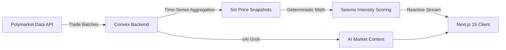

# 🌊 TREMOR.LIVE

> **Open-source real-time prediction market telemetry**

Real-time detection of significant market movements across prediction markets before news breaks. Community-maintained, mathematically robust, transparent, and self-hostable.

<div align="center">
  
[](https://tremor.live)
[](https://github.com/medmond78/tremor/actions)
[](LICENSE)

</div>

## 🎯 What is TREMOR?

TREMOR monitors ~500 active prediction markets on Polymarket in real-time, detecting sudden probability shifts before they hit mainstream headlines. Each movement is scored on a 0–10 intensity scale:

- 🔴 **EXTREME (7.5+)**: Major market earthquakes and sudden breaking consensus
- 🟠 **HIGH (5.0–7.5)**: Significant trading activity and probability shifts
- 🟡 **MODERATE (2.5–5.0)**: Notable price adjustments
- ⚪ **LOW (0–2.5)**: Minor fluctuations

### Features

- ⚡ **Real-Time Reactive Streaming**: Powered by Convex subscriptions without polling
- 📐 **Spoof-Resistant Scoring**: Isolated sub-market scoring prevents illiquid $10 wash trades from distorting event ratings
- ⏱️ **Multi-Timeframe Analysis**: 5-minute, 1-hour, and 24-hour delta tracking
- 🤖 **AI-Powered Explanations**: Real-time context powered by xAI Grok with prompt injection defenses
- 🧪 **Automated Testing Suite**: 100% pure math coverage with Vitest and GitHub Actions CI
- 📱 **Accessible & Responsive**: Fully responsive dark-mode UI with WAI-ARIA compliance

---

## 🚀 Quick Start

```bash
# Clone the repository
git clone https://github.com/medmond78/tremor.git
cd tremor

# Install dependencies
pnpm install

# Set up environment variables
cp .env.example .env.local
# Add your NEXT_PUBLIC_CONVEX_URL and optional XAI_API_KEY

# Run development server
pnpm dev

# Open http://localhost:3000
```

### Verification & Testing

```bash
# Run unit tests (scoring curves, trade bucketing, wash trade prevention)
pnpm test

# Run TypeScript type check
pnpm typecheck

# Run ESLint (Flat Config)
pnpm lint

# Run production build
pnpm build
```

---

## 📊 How It Works

### The Data Pipeline



### Dynamic Priority Sync

TREMOR tiers markets by activity to optimize bandwidth and API quotas:

| Tier        | Activity Profile                | Sync Frequency   | Focus                     |
| ----------- | ------------------------------- | ---------------- | ------------------------- |
| 🔥 **HOT**  | >$50k volume or high volatility | Every 15 seconds | Breaking market movements |
| 🌡️ **WARM** | $5k–$50k volume                 | Every 1 minute   | Active ongoing markets    |
| ❄️ **COLD** | <$5k volume                     | Every 5 minutes  | Low activity markets      |

### The Scoring Algorithm

Intensity scores combine absolute price movement ($\Delta P$) with USD-equivalent volume confidence:

$$\text{Seismo Score} = \min\left(10, \text{round}\left(\text{BaseScore}(\Delta P) \times \text{VolumeMultiplier}(V_{\text{USD}})\right)\right)$$

- **Base Score Curve**:
  - $< 1\text{pp}$: Linear ($0.5\text{pp} \rightarrow 0.5$)
  - $1\text{pp} - 5\text{pp}$: Accelerated ramp ($5\text{pp} \rightarrow 4.5$)
  - $5\text{pp} - 10\text{pp}$: High intensity ($10\text{pp} \rightarrow 7.0$)
  - $10\text{pp} - 20\text{pp}$: Major earthquake ($20\text{pp} \rightarrow 10.0$)
  - $> 20\text{pp}$: Capped at $10.0$

- **Volume Multiplier**:
  - $< \$250$: $0.0$ (filters out illiquid order book manipulation and wash trades)
  - $\ge \$5,000$: $1.0$ (full confidence)
  - $\$250 - \$5,000$: Smooth concave curve $\sqrt{\frac{V - 250}{5000 - 250}}$

---

## 🏗️ Architecture & Tech Stack

- **Frontend**: Next.js 15 (App Router, Turbopack) + React 19 + TypeScript
- **Backend & Database**: Convex (reactive serverless database + crons)
- **Styling**: Tailwind CSS + Typography + Forms
- **Testing**: Vitest
- **AI Context**: xAI Grok API (`grok-2-latest`)
- **CI/CD**: GitHub Actions + Vercel

---

## 📁 Project Structure

```
tremor/
├── .github/workflows/ci.yml # Automated CI pipeline
├── app/                     # Next.js App Router
│   ├── error.tsx            # Telemetry error boundary
│   ├── layout.tsx           # Metadata and font layout
│   ├── page.tsx             # Main live dashboard
│   └── providers.tsx        # Convex reactive client provider
├── components/              # UI components
│   ├── header.tsx           # Status header and branding
│   ├── market-summary.tsx   # AI market trend overview
│   ├── onboarding-modal.tsx # Accessible guided tutorial
│   ├── sidebar.tsx          # Controlled timeframe & intensity filters
│   ├── tremor-card.tsx      # Interactive seismograph market cards
│   └── tremor-detail-panel.tsx # Deep-dive inspection & AI analysis
├── convex/                  # Convex backend
│   ├── actions.ts           # Ingestion pipelines (hot/warm sync)
│   ├── aiActions.ts         # Grok AI explanation generation
│   ├── cleanup.ts           # Indexed data retention cron
│   ├── crons.ts             # Scheduled sync and priority jobs
│   ├── scoring.ts           # Real-time and materialized scoring
│   └── trades.ts            # Atomic 5m trade bucketing
├── lib/                     # Shared utilities
│   ├── scoring.ts           # Pure mathematical scoring engine
│   └── types.ts             # Core domain models and interfaces
└── tests/                   # Vitest unit test suites
    ├── scoring.test.ts      # Scoring math and volatility tests
    └── trades.test.ts       # Bucketing and probability normalization tests
```

---

## 🤝 Contributing

We welcome contributions! Please verify your changes before submitting:

1. Fork the repo and create a feature branch (`git checkout -b feature/my-feature`).
2. Run validation locally:
   ```bash
   pnpm typecheck && pnpm lint && pnpm test && pnpm build
   ```
3. Commit your changes (`git commit -m 'feat: add feature'`).
4. Push to your branch and open a Pull Request.

---

## 📝 License

MIT - see [LICENSE](LICENSE) file for details.
